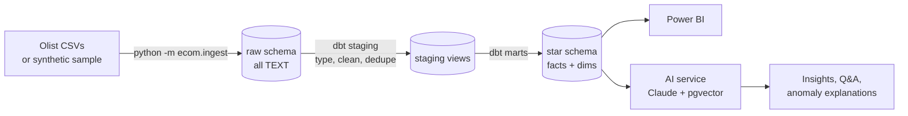
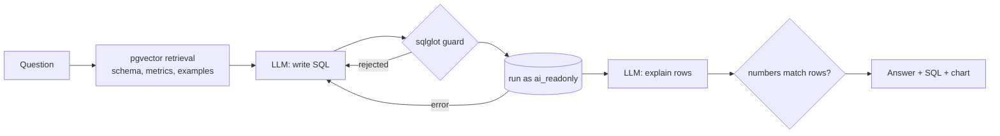

# E-Commerce Sales Analytics & AI Insights

[](https://github.com/abhishekkumar1372/ecommerce-ai-insights/actions/workflows/ci.yml)

An end-to-end analytics platform on the [Olist Brazilian e-commerce dataset](https://www.kaggle.com/datasets/olistbr/brazilian-ecommerce)
(~100k orders, 9 related tables): raw data is loaded into **PostgreSQL**, cleaned and modeled into a star schema
with **dbt**, analyzed with SQL, visualized in **Power BI**, and explained by a **GenAI layer** whose every claim is
checked against the database.

> Status: data foundation, SQL KPIs + Power BI kit, and the GenAI layer are done. Production polish follows.

## Architecture



## Quick start

**With Docker** (Postgres 16 + pgvector, then the full pipeline):

```bash
cp .env.example .env
docker compose up --build pipeline
```

**Locally** (needs a running Postgres):

```bash
make install
make sample      # or: make download   (real Olist data, needs a Kaggle API token)
make ingest      # CSV -> raw schema
make transform   # dbt build: models + 60 data tests
make docs        # lineage graph in the browser
```

## Data model

| Layer | Schema | What it does |
|---|---|---|
| Raw | `raw` | Exact copy of the source files, every column as `TEXT`. Reloadable at any time. |
| Staging | `staging` | Typing, trimming, accent-stripped city names, English categories, de-duplicated reviews, one geo centroid per zip. |
| Marts | `marts` | Star schema used by Power BI and the AI service. |
| Reference | `reference` | `category_margins` seed: the assumed gross margin per category. |

**Facts:** `fct_order_items` (one row per item sold: revenue, freight, estimated profit, outlier flag) and
`fct_orders` (one row per order: payments, delivery days, late flag, review score).
**Dimensions:** `dim_date`, `dim_customer`, `dim_product`, `dim_seller`.

### Cleaning decisions

- **Duplicate reviews:** the source has exact duplicate rows and orders with several reviews; we keep the latest answered one per order.
- **Untranslated categories:** some Portuguese categories are missing from the translation file; they fall back to the Portuguese name, and products with no category become `unknown`.
- **City names:** `São Paulo`, `SAO PAULO` and `sao paulo` are normalised to one value.
- **Freight outliers:** values above the 99.9th percentile are flagged, not deleted, so totals still reconcile.
- **Profit is an estimate.** Olist has no cost data, so `est_gross_profit = price × assumed margin` from `dbt/seeds/category_margins.csv`. Change the seed to run scenarios.

### Data tests

`dbt build` runs 60+ tests: primary-key uniqueness, not-null, referential integrity between every fact and
dimension, accepted values, non-negative amounts, and two business checks:
revenue in `fct_orders` reconciles exactly with `fct_order_items`, and payments cover order value (warning).

## Synthetic sample data

`python -m ecom.sample_data` writes files with the exact Olist layout, including the same kinds of problems
(duplicates, missing delivery dates, untranslated categories, outliers, a Black Friday spike), so the whole
pipeline runs in CI and without a Kaggle account. Real analysis and screenshots use the real dataset.

## GenAI layer

The AI never reads raw tables and is never trusted on numbers. The model is swappable: **Google Gemini**
(`gemini-2.5-flash`, free tier) or **Claude** (`claude-opus-5-5`), both with JSON-schema structured output.
Set `GEMINI_API_KEY` or `ANTHROPIC_API_KEY`; `LLM_PROVIDER` forces one. Guardrails and logging are identical
for both. Three features:

| Feature | How it works | Guardrail |
|---|---|---|
| **Executive summary** (`make summary`) | Fixed KPI queries become *facts*, each with its source SQL. The model writes wins, risks and 3 actions, citing fact ids. | Every number in the text must match a cited fact (after rounding and unit handling). On failure the errors go back to the model once; the result and the check are stored in `ai.ai_insights`. |
| **Ask your data** (text-to-SQL) | The question retrieves table docs, metric definitions and worked examples from **pgvector**; the model writes SQL; the result is explained in plain English. | `sqlglot` allows one `SELECT` on `marts`/`kpi` only and caps rows. It runs as role `ai_readonly` (SELECT-only, 10s timeout, read-only transaction). Errors are fed back for up to 2 retries. Answer numbers are checked against the result rows. |
| **Anomaly explainer** (`make anomalies`) | Days more than 3σ from their 28-day baseline are flagged in SQL, then drilled down by category and state. The model explains the drivers. | Same fact-check; the cause is labelled a hypothesis. On the sample data it finds the planted Black Friday spike. |



**LLMOps:** every call logs tokens, latency and cost to `ai.llm_calls` (see the *LLM usage* tab).
`make evals` scores text-to-SQL by **execution accuracy** on 16 gold questions (`evals/text_to_sql.yml`) and
measures how often summaries pass the fact-check first time. The test suite runs the whole AI pipeline with a
fake model, so CI needs no API key.

**Run it:** `export GEMINI_API_KEY=...` (free key from https://aistudio.google.com/apikey), then `make app` (Streamlit on :8501) or `make api` (FastAPI on :8000,
docs at `/docs`), or `docker compose up` for everything.

| Endpoint | Purpose |
|---|---|
| `POST /ask` | Question → SQL, rows, answer, fact-check |
| `POST /insights/generate`, `GET /insights/latest` | Executive summary |
| `GET /anomalies`, `POST /anomalies/{day}/explain` | Anomalies |
| `GET /llm/usage` | Tokens, latency and cost per feature |

## Roadmap

- [x] **1. Data foundation:** Docker, ingestion, dbt staging + star schema, tests, CI
- [x] **2. SQL KPIs + Power BI:** growth, moving averages, Pareto, RFM segments, cohort retention, Power BI kit (`powerbi/`)
- [x] **3. GenAI layer:** fact-checked executive summaries, text-to-SQL with RAG over pgvector, anomaly explainer
- [ ] **3b. Review themes:** classify review text into themes and link them to revenue
- [ ] **4. Production polish:** scheduled refresh, deployment, Power BI screenshots, demo video

## Project layout

```
src/ecom/        ingestion, Kaggle download, synthetic data generator
src/ecom/ai/     LLM client, facts, fact-check, text-to-SQL, retrieval, anomalies, API, evals
app/             Streamlit app
evals/           gold questions for text-to-SQL
dbt/models/      staging/ and marts/ SQL models with tests
dbt/seeds/       category margin assumptions
db/init/         Postgres init: pgvector extension, read-only AI role
tests/           pytest unit + integration tests
```
