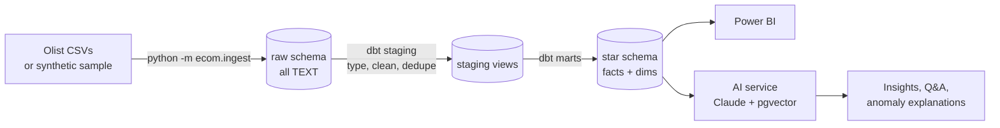

# E-Commerce Sales Analytics & AI Insights

[](https://github.com/abhishekkumar1372/ecommerce-ai-insights/actions/workflows/ci.yml)

An end-to-end analytics platform on the [Olist Brazilian e-commerce dataset](https://www.kaggle.com/datasets/olistbr/brazilian-ecommerce)
(~100k orders, 9 related tables): raw data is loaded into **PostgreSQL**, cleaned and modeled into a star schema
with **dbt**, analyzed with SQL, visualized in **Power BI**, and explained by a **GenAI layer** whose every claim is
checked against the database.

> Status: **Milestone 1, data foundation** is done. KPI SQL + Power BI, the GenAI layer and production polish follow.

## Architecture



## Quick start

**With Docker** (Postgres 16 + pgvector, then the full pipeline):

```bash
cp .env.example .env
docker compose up --build pipeline
```

**Locally** (needs a running Postgres):

```bash
make install
make sample      # or: make download   (real Olist data, needs a Kaggle API token)
make ingest      # CSV -> raw schema
make transform   # dbt build: models + 60 data tests
make docs        # lineage graph in the browser
```

## Data model

| Layer | Schema | What it does |
|---|---|---|
| Raw | `raw` | Exact copy of the source files, every column as `TEXT`. Reloadable at any time. |
| Staging | `staging` | Typing, trimming, accent-stripped city names, English categories, de-duplicated reviews, one geo centroid per zip. |
| Marts | `marts` | Star schema used by Power BI and the AI service. |
| Reference | `reference` | `category_margins` seed: the assumed gross margin per category. |

**Facts:** `fct_order_items` (one row per item sold: revenue, freight, estimated profit, outlier flag) and
`fct_orders` (one row per order: payments, delivery days, late flag, review score).
**Dimensions:** `dim_date`, `dim_customer`, `dim_product`, `dim_seller`.

### Cleaning decisions

- **Duplicate reviews:** the source has exact duplicate rows and orders with several reviews; we keep the latest answered one per order.
- **Untranslated categories:** some Portuguese categories are missing from the translation file; they fall back to the Portuguese name, and products with no category become `unknown`.
- **City names:** `São Paulo`, `SAO PAULO` and `sao paulo` are normalised to one value.
- **Freight outliers:** values above the 99.9th percentile are flagged, not deleted, so totals still reconcile.
- **Profit is an estimate.** Olist has no cost data, so `est_gross_profit = price × assumed margin` from `dbt/seeds/category_margins.csv`. Change the seed to run scenarios.

### Data tests

`dbt build` runs 60+ tests: primary-key uniqueness, not-null, referential integrity between every fact and
dimension, accepted values, non-negative amounts, and two business checks:
revenue in `fct_orders` reconciles exactly with `fct_order_items`, and payments cover order value (warning).

## Synthetic sample data

`python -m ecom.sample_data` writes files with the exact Olist layout, including the same kinds of problems
(duplicates, missing delivery dates, untranslated categories, outliers, a Black Friday spike), so the whole
pipeline runs in CI and without a Kaggle account. Real analysis and screenshots use the real dataset.

## Roadmap

- [x] **1. Data foundation:** Docker, ingestion, dbt staging + star schema, tests, CI
- [ ] **2. SQL KPIs + Power BI:** growth, moving averages, Pareto, RFM segments, cohort retention, 4-page dashboard
- [ ] **3. GenAI layer:** fact-checked executive summaries, text-to-SQL with RAG over pgvector, anomaly explainer, review themes
- [ ] **4. Production polish:** LLM evals in CI, cost/latency logging, scheduled refresh, deployment, demo video

## Project layout

```
src/ecom/        ingestion, Kaggle download, synthetic data generator
dbt/models/      staging/ and marts/ SQL models with tests
dbt/seeds/       category margin assumptions
db/init/         Postgres init: pgvector extension, read-only AI role
tests/           pytest unit + integration tests
```
